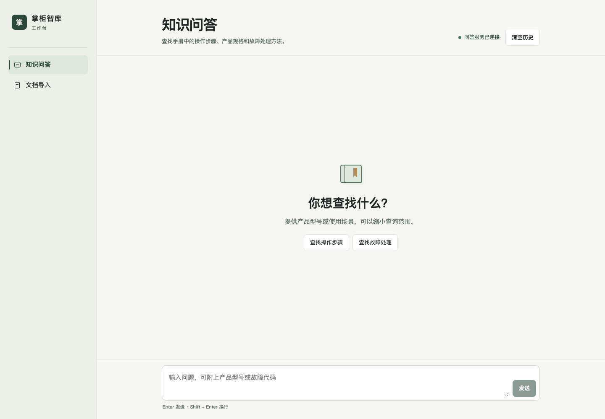

# AfterLink 知识工作台

AfterLink 是一个本地运行的文档知识库与问答应用：导入 PDF 或 Markdown，进行向量与图谱检索，并在统一工作台中查询知识库。



## 功能

- **统一工作台**：问答和文档导入入口集中在同一界面。
- **文档导入**：PDF 通过 MinerU 解析，Markdown 可直接导入；处理结果进入 Milvus，并建立 Neo4j 图谱数据。
- **混合检索与问答**：使用本地 BGE-M3 向量模型、Milvus 和 BGE Reranker，结合配置的 LLM 生成回答。
- **本地数据服务**：Docker Compose 管理 MongoDB、Milvus、MinIO、etcd 和 Neo4j。
- **可选网络搜索**：可配置 DashScope WebSearch MCP。

## 架构与目录

| 路径 | 说明 |
| --- | --- |
| `app/query_process/` | 问答 API、检索工作流和统一工作台 |
| `app/import_process/` | PDF/Markdown 导入 API、处理工作流和导入页面 |
| `app/clients/` | MongoDB、Milvus、Neo4j、MinIO 客户端 |
| `app/lm/` | LLM、嵌入与重排模型适配 |
| `prompts/` | 导入和问答提示词 |
| `compose.yaml` | 本地数据服务容器配置 |
| `.env.example` | 环境变量模板 |

## 环境要求

- macOS 或 Linux
- Conda、Python 3.11+
- Docker Desktop 或 Docker Engine，以及 Docker Compose 插件
- LLM 服务商的 API 凭据
- MinerU API 凭据（导入 PDF 时需要）
- 本地 BGE-M3 和 BGE Reranker 模型文件
- 可选：DashScope API Key（启用 WebSearch MCP 时需要）

模型权重不随仓库提供。请先准备好模型文件，并在 `.env` 中填写本机模型目录。首次安装 Python 依赖和下载模型需要较多时间与磁盘空间。

## 快速开始

以下命令从仓库根目录执行。Python 依赖由 `pyproject.toml` 和 `uv.lock` 管理；建议使用新的 Conda 环境，避免锁文件同步影响已有环境中的其他包。

### 1. 创建环境并安装依赖

```bash
conda create -n after-link python=3.11 -y
conda activate after-link
python -m pip install uv
uv sync --active --frozen --no-install-project
```

### 2. 配置服务

```bash
cp .env.example .env
```

编辑 `.env`，填入模型服务、MinerU、本地模型路径和数据库连接信息。密钥只保存在本机 `.env`，不要提交到 Git。

Docker Compose 为本地开发提供了 MongoDB、MinIO、Neo4j 的开发凭据默认值；如果要连接自有服务或调整本机配置，请在 `.env` 中覆盖。Compose 端口仅绑定到本机回环地址。

### 3. 启动数据服务

```bash
docker compose up -d
```

检查容器状态和日志：

```bash
docker compose ps
docker compose logs -f mongo milvus minio neo4j
```

### 4. 启动 API

分别在两个终端运行。两个服务默认仅监听本机：

```bash
conda activate after-link
uvicorn app.import_process.api.file_import_service:app --host 127.0.0.1 --port 8002
```

```bash
conda activate after-link
uvicorn app.query_process.api.query_service:app --host 127.0.0.1 --port 8003
```

### 5. 打开页面并检查服务

- 统一问答工作台：<http://127.0.0.1:8003/>
- 文档导入页面：<http://127.0.0.1:8002/import.html>
- 问答服务健康检查：<http://127.0.0.1:8003/health>
- 问答 API 文档：<http://127.0.0.1:8003/docs>
- 导入 API 文档：<http://127.0.0.1:8002/docs>
- Neo4j Browser：<http://127.0.0.1:7476/>
- MinIO Console：<http://127.0.0.1:9001/>

`/health` 只检查问答 API 进程是否可响应；数据库、模型和外部 API 的可用性还需结合容器状态及具体导入/问答流程检查。

## 配置项

`.env.example` 列出全部变量。主要配置如下：

| 配置 | 用途 |
| --- | --- |
| `OPENAI_BASE_URL`、`OPENAI_API_KEY` | OpenAI 兼容的 LLM 服务地址和密钥 |
| `VL_MODEL`、`LLM_DEFAULT_MODEL`、`LLM_DEFAULT_TEMPERATURE` | 视觉模型、问答模型和生成温度 |
| `MINERU_BASE_URL`、`MINERU_API_TOKEN` | PDF 解析服务 |
| `BGE_M3_PATH`、`BGE_DEVICE`、`BGE_FP16` | BGE-M3 本地模型路径和运行参数 |
| `BGE_RERANKER_LARGE`、`BGE_RERANKER_DEVICE`、`BGE_RERANKER_FP16` | BGE Reranker 本地模型路径和运行参数 |
| `MILVUS_URL`、`CHUNKS_COLLECTION`、`ENTITY_NAME_COLLECTION`、`ITEM_NAME_COLLECTION` | Milvus 地址和集合名 |
| `MONGO_URL`、`MONGO_DB_NAME` | MongoDB 地址和数据库名 |
| `MINIO_ENDPOINT`、`MINIO_ACCESS_KEY`、`MINIO_SECRET_KEY`、`MINIO_BUCKET_NAME` | MinIO 连接和存储桶配置 |
| `NEO4J_URI`、`NEO4J_USERNAME`、`NEO4J_PASSWORD` | Neo4j 连接配置 |
| `DASHSCOPE_API_KEY`、`MCP_DASHSCOPE_BASE_URL` | 可选的 DashScope WebSearch MCP 配置；模板中已提供服务地址 |

本地 Compose 服务端口：MongoDB `27017`、Milvus `19530`、MinIO API `9000`、MinIO Console `9001`、Neo4j Browser `7476`、Neo4j Bolt `7688`。修改端口映射后，也要同步更新 `.env` 中对应服务地址。

## 常用操作

停止 API：在各自终端按 `Ctrl+C`。

停止容器并保留数据卷：

```bash
docker compose down
```

查看指定容器日志：

```bash
docker compose logs -f <服务名>
```

不要随意执行 `docker compose down -v`：该命令会删除 Compose 数据卷及其中保存的本地数据库数据。

## API 入口

| 服务 | 方法与路径 | 说明 |
| --- | --- | --- |
| 问答 | `POST /query` | 提交问答，可选择流式响应 |
| 问答 | `GET /stream/{session_id}` | 获取流式输出 |
| 问答 | `GET /history/{session_id}` | 查询会话历史 |
| 问答 | `DELETE /history/{session_id}` | 清除会话历史 |
| 导入 | `POST /upload` | 上传文件并启动后台导入 |
| 导入 | `GET /status/{task_id}` | 查询导入任务状态 |

## 数据与安全

- `.env`、PDF 手册、模型权重、日志和导入产物属于本地数据，不提交到仓库。
- 默认 Compose 密码仅供本机开发；部署到其他环境前请替换为独立凭据。
- API 当前用于本地开发。对外部署前应配置身份验证、限制跨域来源，并评估文件上传与网络访问策略。

## 许可证

本项目使用 [MIT License](LICENSE)。
